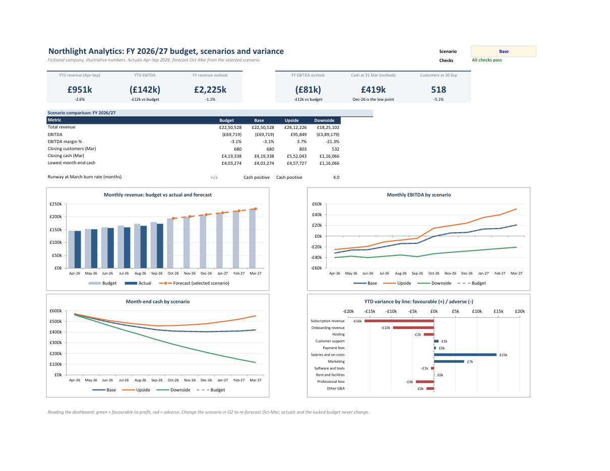
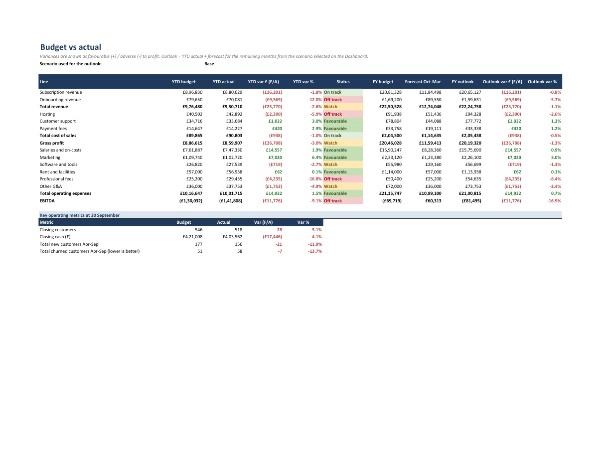
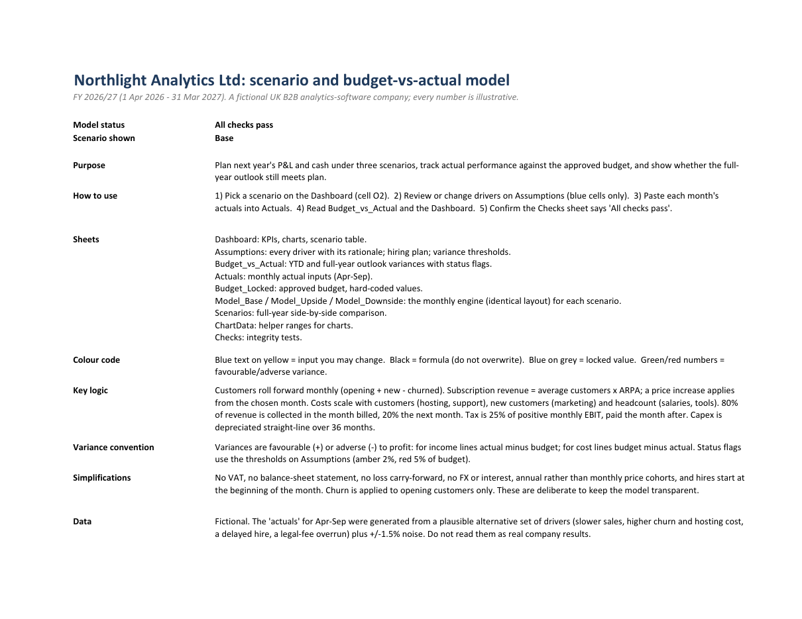

# Scenario and Budget-vs-Actual Model in Excel

Author: Anurag Moyal

A finance workbook for a fictional UK B2B software company (**Northlight Analytics Ltd**): a driver-based **three-scenario forecast**, a **locked budget** with **budget-vs-actual variance analysis**, a **dashboard**, and every assumption documented. The workbook is `Northlight_Scenario_Budget_Model.xlsx` (Excel 2016 or later; no macros).



## What it demonstrates
* **Driver-based modelling.** Customers, price, churn, hiring, costs and cash flow all flow from 27 documented drivers plus a hiring plan. Nothing in the engine is hard-coded: every month cell on the three scenario sheets is a formula.
* **Scenario analysis.** Base / Upside / Downside run side by side on identical engine sheets; one dropdown on the Dashboard re-forecasts the remaining months.
* **Variance analysis a finance team would recognise.** A locked budget, actuals input sheet, favourable/adverse variances (sign-adjusted for income vs cost lines), amber/red status thresholds you can change, and a full-year outlook (YTD actual + forecast).
* **Model integrity.** 20 automated checks (cash and customer roll-forwards, P&L tie-outs, error scans, budget-lock information) roll up to one status shown on the Cover and Dashboard.
* **Independent verification.** The workbook's formulas were recalculated in Excel and compared cell by cell with a separate Python implementation of the same model: **all 1,404 engine cells (468 per scenario across Base, Upside and Downside) and every variance-table cell, with zero mismatches** (`src/verify.py`).

## The story the numbers tell (Base case, as of 30 Sep 2026)
| | Budget | Actual / outlook | Variance |
|---|---:|---:|---:|
| YTD revenue (Apr-Sep) | £976,480 | £950,710 | -£25,770 (-2.6%, Watch) |
| YTD EBITDA | -£130,032 | -£141,808 | -£11,776 (-9.1%, Off track) |
| Closing customers, 30 Sep | 546 | 518 | -28 (-5.1%) |
| FY revenue outlook | £2,250,528 | £2,224,758 | -£25,770 (-1.1%) |
| FY EBITDA outlook | -£69,719 | -£81,495 | -£11,776 (-16.9%) |

* **The revenue shortfall is volume-driven:** new customers are 21 (11.9%) below plan and churn is 7 customers above plan, leaving closing customers 28 (5.1%) short.
* **Two cost lines are the big adverse movers:** professional fees (-16.8%, a legal overrun) and hosting (-5.9%). They are more than offset by under-spend on salaries (a hire slipped from June to July) and marketing (fewer customers acquired), so total operating expenses are £14.9k favourable.
* **Scenario range for the full year:** Upside revenue £2.61m and EBITDA +£95.8k; Downside revenue £1.83m, EBITDA -£389.2k, and cash falling to **£116k by March with about 4 months' runway at the March burn rate**. Under the Base case cash bottoms out at £403k in December.



## How to use
1. Open the workbook. Pick a scenario in **Dashboard!O2**.
2. Change drivers on **Assumptions** (blue text on yellow only). Each has a unit and a rationale.
3. Paste each month's actuals into **Actuals** (blue cells); totals are formulas.
4. Read **Budget_vs_Actual** and the **Dashboard**. Confirm **Checks** says "All checks pass".

The **Budget_Locked** sheet is values, not formulas: it holds the Base case as approved on 1 April, so variances do not move when you experiment with the live scenarios. The Checks sheet tells you if the live Base case has drifted from the locked budget.

Sheet guide, colour code, logic and simplifications are on the workbook's **Cover** sheet:



## Key modelling logic
* Customers: opening + new - churned. New customers grow at a compounding monthly rate; churn applies to opening customers.
* Revenue: average customers x ARPA (with a price rise from October) + onboarding fee per new customer.
* Costs: hosting and support per average customer, marketing = CAC x new customers, salaries and tools by headcount (hiring plan per scenario), fixed rent and overheads.
* Cash: 80% of revenue collected in the month, 20% the next; costs paid in the month; tax (25% of positive monthly EBIT) paid the month after; capex depreciated over 36 months.

## Files
```
Northlight_Scenario_Budget_Model.xlsx   the deliverable
src/model_spec.py        assumptions, scenarios, locked-budget values, fictional actuals, Python mirror of the model
src/build_workbook.py    writes the workbook (xlsxwriter) - every calculation is an Excel formula
src/recalc_and_dump.ps1  recalculates in desktop Excel and dumps values (Windows + Excel)
src/verify.py            compares Excel's results to the Python mirror
src/finalize.ps1         build + verify all three scenarios + save with cached values
tests/test_model.py      10 tests that need no Excel (invariants, workbook structure, no hard-coded engine cells)
docs/images/             screenshots
```
Rebuild: `pip install -r requirements.txt && python src/build_workbook.py` (any OS). Full rebuild plus Excel verification: `powershell -File src\finalize.ps1`. Tests: `python -m pytest -q`.

## Assumptions and limitations
* **Everything is fictional and illustrative**, including the "actuals" for Apr-Sep, which were generated from a plausible alternative set of drivers plus ±1.5% noise. Do not read them as real company results.
* Deliberate simplifications: no VAT, no balance sheet, no loss carry-forward, no interest or FX, hires start at the beginning of the month, churn applies to opening customers only, one price increase per year.
* Scenarios are single-point cases, not probability-weighted; there is no Monte Carlo or sensitivity table.
* The workbook's screenshots were rendered on a machine with Indian digit grouping, so large numbers show as e.g. £22,50,528; on a UK or US setting they show as £2,250,528.
* Rounding: new and churned customers are rounded to whole customers each month, as in practice.

MIT licensed.
